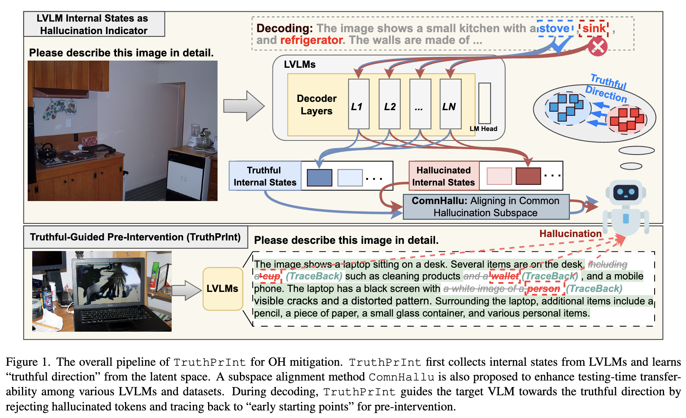

# TruthPrInt: Mitigating Large Vision-Language Models Object Hallucination Via Latent Truthful-Guided Pre-Intervention
- **Authors:** Jinhao Duan*, Fei Kong*, Hao Cheng, James Diffenderfer, Bhavya Kailkhura, Lichao Sun, Xiaofeng Zhu, Xiaoshuang Shi, Kaidi Xu (*equal contribution)
- [**paper**](https://openaccess.thecvf.com/content/ICCV2025/papers/Duan_TruthPrInt_Mitigating_Large_Vision-Language_Models_Object_Hallucination_Via_Latent_Truthful-Guided_ICCV_2025_paper.pdf)



Object Hallucination (OH) has been acknowledged as one of the major trustworthy challenges in Large Vision-Language Models (LVLMs).
Recent advancements in Large Language Models (LLMs) indicate that internal states, such as hidden states, encode the "overall truthfulness" of generated responses. However, it remains under-explored how internal states in LVLMs function and whether they could serve as "per-token" hallucination indicators, which is essential for mitigating OH.
In this paper, we first conduct an in-depth exploration of LVLM internal states with OH issues and discover that (1) LVLM internal states are per-token indicators of hallucination behaviors. Moreover, (2) different LVLMs encode universal patterns of hallucinations in common latent subspaces, indicating that there exist "generic truthful directions" shared by various LVLMs. 
Based on these discoveries, we propose Truthful-Guided Pre-Intervention (TruthPrInt) that first learns the truthful direction of LVLM decoding and then applies truthful-guided inference-time intervention during LVLM decoding. We further propose ComnHallu to enhance both cross-LVLM and cross-data hallucination detection transferability by constructing and aligning hallucination latent subspaces.
We evaluate TruthPrInt in extensive experimental settings, including in-domain and out-of-domain scenarios, over popular LVLMs and OH benchmarks. Experimental results indicate that TruthPrInt significantly outperforms state-of-the-art methods. 

## Environment

This project is highly based on [HALC](https://github.com/BillChan226/HALC). Please refer to it for environment preparation and COCO dataset download.

## TruthPrInt Decoding
By default, TruthPrInt uses the classifier trained over on the **MiniGPT-4 Hidden States from the CCSBU dataset**. We provide the pretrained classifier weights in:
`./classifier_hidden_states_previous_hs/chair/minigpt4/minigpt4_cc_sbu_align_3k_layer16_checkpoint.pth`.

The following is an example that use this classifier to guide the decoding of `MiniGPT4` on the `COCO-2014val` random 500 images:

```shell
python run_scripts/caption_generation.py \
    --num_samples 500 \
    --skip_num 0 \
    --verbosity 1 \
    --decoder classifier \
    --output_dir ./experiment_results \
    --gpu-id 0 \
    --split val2014 \
    --seed 42 \
    --data_path /path/to/coco2014 \
    --hs_position previous \
    --classifier_task classify-hallucination \
    --classifier_ckpt_path ./classifier_hidden_states_previous_hs/chair/minigpt4/best_model_checkpoint.pth \ # path to the detector checkpint
    --classifier_threshold 0.9 \
    --max_new_tokens 64 \
    --batch_size 1 # batchsize can only be 1
```

## Prepare Classifier from Scratch
If you want to train your classifer from scratch, you could collect hidden states from a LVLM and then train an classifier over them:

### Collect truthful and hallucinated hidden states
(change the option `--classifier_task` to `collect-hidden-states`)
```shell
python run_scripts/caption_generation.py \
    --num_samples 500 \
    --skip_num 0 \
    --verbosity 1 \
    --decoder classifier \
    --output_dir ./experiment_results \
    --gpu-id 0 \
    --split val2014 \
    --seed 42 \
    --data_path /path/to/coco2014 \
    --hs_position previous \
    --classifier_task collect-hidden-states \
    --max_new_tokens 64 \
    --batch_size 1 # batchsize can only be 1
```

### Train classifier

Please refer to `./decoder_zoo/Classifier/classifier_training.py` for classifier training.

# Reference

Please cite our paper as
```
@inproceedings{duan2025truthprint,
  title={TruthPrInt: Mitigating Large Vision-Language Models Object Hallucination Via Latent Truthful-Guided Pre-Intervention},
  author={Duan, Jinhao and Kong, Fei and Cheng, Hao and Diffenderfer, James and Kailkhura, Bhavya and Sun, Lichao and Zhu, Xiaofeng and Shi, Xiaoshuang and Xu, Kaidi},
  booktitle={Proceedings of the IEEE/CVF International Conference on Computer Vision},
  pages={7372--7382},
  year={2025}
}
```
